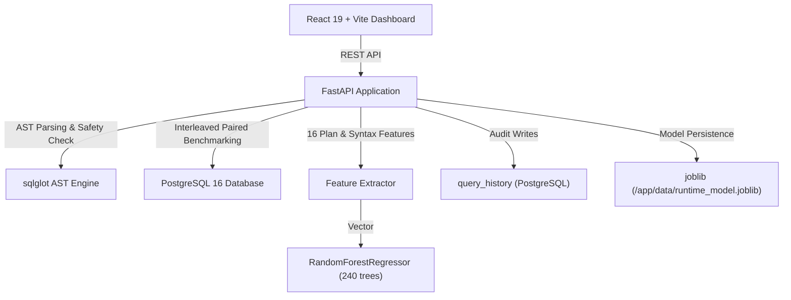

# Intelligent Query Optimization in Modern Database Systems

A research-oriented full-stack system for machine-learning-assisted database query runtime forecasting, AST-backed semantic difference analysis, and controlled before-and-after query rewrite benchmarking on PostgreSQL 16.

---

## 1. Problem Statement
Relational Database Management Systems (RDBMS) like PostgreSQL rely on cost-based query optimizers (CBO) designed decades ago (e.g., System R). Cost-based optimizers rely on cost models and static statistical heuristics (histograms, most-common-value lists) that compute unitless "cost" values rather than physical execution latency.

These static models frequently suffer from significant estimation errors due to:
- **Attribute Value Independence (AVI) assumptions:** Underestimating cardinality when column predicates correlate (e.g., `make = 'Audi'` and `model = 'A4'`).
- **Hardware-decoupled cost units:** PostgreSQL cost units do not correspond linearly to wall-clock milliseconds across diverse caching, I/O, and CPU states.
- **Cheating and non-equivalent comparisons:** In informal benchmarking, practitioners frequently claim performance gains by comparing rewritten queries that return fewer rows (e.g., adding `LIMIT` or altering filter predicates), conflating reduced computational workload with true relational optimization.
- **Microbenchmark jitter conflation:** Small run-to-run variances (<0.2 ms) are often falsely advertised as true optimizations without rigorous materiality thresholds or uncertainty bounds.

---

## 2. Research Motivation
Modern data engineering and analytics workloads require predictable Service Level Objectives (SLOs) and rapid root-cause analysis for slow queries. While the native database optimizer chooses among join orders and scan methods, database engineers must determine:
1. What will the physical execution latency of a candidate query be before executing it?
2. Does a proposed SQL rewrite preserve relational semantics while reducing physical latency?
3. How much execution time does a rewritten query save when tested under repeated, controlled database conditions?

This project investigates how learned machine learning models (specifically ensemble decision tree regression) trained on historical execution plans can forecast physical query runtime, and how automated AST analysis combined with bounded multiset equivalence checks and paired bootstrap uncertainty can enforce fair query optimization benchmarks.

---

## 3. Existing Solutions
- **Traditional Cost-Based Optimizers (PostgreSQL, MySQL, Oracle):** Compute symbolic cost units based on disk page accesses (`seq_page_cost`, `random_page_cost`) and CPU tuple processing (`cpu_tuple_cost`). They do not forecast physical runtime in milliseconds and do not adapt to historical runtime feedback.
- **Heuristic Query Rewriters:** Apply static rewrite rules (predicate pushdown, subquery unnesting, view merging). They do not evaluate empirical wall-clock runtimes.
- **Learned DBMS Components (Academic prototypes like Neo, SageDB, Bao):** Replace or steer native query planners using deep reinforcement learning or tree-convolutional neural networks. While promising, they often require intrusive DBMS engine modifications, massive training datasets, or heavy GPU runtimes that are impractical for lightweight production environments.

---

## 4. Research Gaps
1. **Disconnection between Estimated Cost and Physical Runtime:** PostgreSQL's `Total Cost` is unitless and non-linear. A query with an estimated cost of 500 may run faster than one with a cost of 100 if data pages reside in the OS buffer cache.
2. **Data Leakage in Learned DBMS Benchmarks:** Prior ML evaluations frequently suffer from temporal and query-family data leakage: identical query templates evaluated repeatedly appear in both training and test sets, artificially inflating accuracy scores.
3. **Absence of Semantic Guardrails in Benchmarking:** Existing database benchmark dashboards compare baseline and revised SQL without verifying whether the two queries produce identical relational outputs, rewarding queries that simply truncate data.
4. **Statistical Overconfidence in Small Samples:** Claiming "statistically significant" speedups based on small sample repetitions without distinguishing practical materiality from statistical uncertainty.

---

## 5. Proposed Solution
This system provides an end-to-end framework combining:
1. **Learned Runtime Estimation:** A 240-tree Random Forest Regressor trained on 16 engineered syntactic and execution-plan features extracted from PostgreSQL's `EXPLAIN` engine prior to execution, providing point estimates and tree-quantile uncertainty bands (10th–90th percentile).
2. **Leakage-Free Grouped Holdout Evaluation:** Grouped holdout splitting by unique query family and fingerprint to measure true structural generalization to unseen query patterns.
3. **Naive Central-Tendency Baseline Benchmarking:** Explicit comparison against a training-set median runtime baseline, reporting MAE, RMSE, and median relative percentage error (MdAPE).
4. **AST-Backed Semantic Analysis & Bounded Multiset Equivalence:** Automatic AST parsing via `sqlglot` to detect changes in `LIMIT`, `WHERE`, `JOIN`, `GROUP BY`, and projections, combined with bounded `row_to_json` multiset equivalence verification (preserving duplicate rows and respecting `ORDER BY`).
5. **Rigorous Materiality Thresholds & Bootstrap Uncertainty:** Evaluates latency delta against strict materiality thresholds (requires both $\ge 0.20$ ms absolute change and $\ge 5.0\%$ relative change) and paired bootstrap 95% confidence intervals, classifying sub-0.2 ms differences as `INCONCLUSIVE`.

> **Important Clarification:** The current system performs learned runtime estimation, query-plan analysis, and controlled query-rewrite evaluation. It does not replace PostgreSQL's internal CBO search space, but equips engineers with rigorous empirical verification tools.

---

## 6. System Architecture



### Components:
- **Frontend:** React 19, TypeScript, Vite. Modular tabbed interface (`Query Analyzer`, `Latency Charts`, `Compare Rewrites`, `Execution Plan`, `ML Intelligence`, `Audit History`).
- **Backend:** FastAPI, Python 3.12, Uvicorn.
- **Database Engine:** PostgreSQL 16. Controlled schema with least-privilege `query_reader` user and admin-isolated migration tracking.
- **ML Runtime:** Scikit-learn Random Forest Regressor persisted with `joblib`.

---

## 7. Machine Learning Methodology
- **Target Label:** Real physical execution runtime in milliseconds (`runtime_ms`) measured via PostgreSQL `EXPLAIN (ANALYZE, BUFFERS, FORMAT JSON)`.
- **Model:** `RandomForestRegressor` with 240 estimator trees, `min_samples_leaf=2`, `random_state=42`.
- **Inference Inputs:** Estimated plan features extracted from `EXPLAIN (FORMAT JSON)` (without ANALYZE) prior to execution, combined with normalized SQL syntactic tokens.
- **Uncertainty Quantification:** Tree-quantile interval calculated across the individual decision tree forecasts:
  $$\text{Lower Bound} = Q_{0.10}(\hat{y}), \quad \text{Upper Bound} = Q_{0.90}(\hat{y})$$
- **Evaluation Splitting Strategy:** Grouped query-family holdout split. 25% of distinct query families are isolated into the validation set, ensuring zero repeated query templates between training and holdout evaluation.
- **Evaluation Metrics:**
  - Mean Absolute Error (MAE): $\frac{1}{N} \sum |y_i - \hat{y}_i|$
  - Root Mean Squared Error (RMSE): $\sqrt{\frac{1}{N} \sum (y_i - \hat{y}_i)^2}$
  - Median Absolute Percentage Error (MdAPE) with safe 0.05 ms floor: $\text{median}\left(\frac{|y_i - \hat{y}_i|}{\max(y_i, 0.05)}\right) \times 100\%$

---

## 8. Feature Engineering (16 Dimensions)

| Feature Index | Feature Name | Source | Description |
|---|---|---|---|
| 0 | `sql_length` | SQL String | Character length of normalized SQL statement |
| 1 | `join_count` | SQL Regex | Count of `JOIN` relational keywords |
| 2 | `predicate_count` | SQL Regex | Count of `WHERE`, `AND`, `OR` filter clauses |
| 3 | `aggregate_count` | SQL Regex | Count of SQL aggregate functions (`COUNT`, `SUM`, `AVG`, `MIN`, `MAX`) |
| 4 | `has_order_by` | SQL Boolean | Presence of explicit sorting clause (0.0 or 1.0) |
| 5 | `has_distinct` | SQL Boolean | Presence of row deduplication (0.0 or 1.0) |
| 6 | `subquery_count` | SQL Regex | Count of nested `(SELECT ...)` subqueries |
| 7 | `has_limit` | SQL Boolean | Presence of result set truncation clause (0.0 or 1.0) |
| 8 | `plan_cost` | EXPLAIN Plan | Root node total cost estimated by PostgreSQL CBO |
| 9 | `plan_rows` | EXPLAIN Plan | Root node estimated row cardinality |
| 10 | `node_count` | EXPLAIN Plan | Total number of execution plan tree nodes |
| 11 | `seq_scan_count` | EXPLAIN Plan | Count of sequential table scans (`Seq Scan`) |
| 12 | `index_scan_count`| EXPLAIN Plan | Count of index scans (`Index Scan` + `Index Only Scan`) |
| 13 | `join_node_count` | EXPLAIN Plan | Count of physical join nodes (`Nested Loop`, `Hash Join`, `Merge Join`) |
| 14 | `sort_count` | EXPLAIN Plan | Count of physical sort nodes (`Sort`) |
| 15 | `aggregate_node_count` | EXPLAIN Plan | Count of physical aggregation nodes (`Aggregate`, `HashAggregate`) |

---

## 9. Dataset and Workload Generation
The database schema models an e-commerce platform with 5,000 customers and 30,000 orders seeded deterministically with random seed 42.

The workload generator (`backend/scripts/collect_training_data.py`) executes across **9 distinct query families**:
1. `pk_lookup`: Primary-key unique lookups (`customers WHERE id = ?`, `orders WHERE id = ?`).
2. `selective_index`: Selective filters leveraging the composite index `(customer_id, created_at)`.
3. `non_selective_filter`: Low-selectivity status and regional filters triggering Bitmap/Seq Scans.
4. `aggregation`: Multi-metric aggregations (`GROUP BY status`, `SUM(total)`).
5. `sorting_limit`: Top-N sorting queries testing in-memory heap sorting vs quicksort.
6. `single_table_scan`: Full-table sequential scans with computed scalar expressions.
7. `multi_table_join`: Two-table relational joins with row filtering.
8. `grouped_aggregate_join`: Multi-table joins combined with regional aggregations and sorting.
9. `cte_subquery`: Common Table Expressions (`WITH ... SELECT`) and correlated subqueries.

All executions are tagged with query families, fingerprints, planning times, execution times, buffer cache hit/read blocks, and persisted into `query_history`.

---

## 10. Experimental Setup
- **Operating System:** Windows 11 host with Docker Desktop.
- **Database Engine:** PostgreSQL 16 official Docker image.
- **Shared Buffers:** Default PostgreSQL container configuration.
- **Statement Timeout:** 5,000 ms per query transaction.
- **Measurement Policy:** 1 unrecorded warm-up run followed by $N$ repeated measurements ($N \in [3, 50]$).
- **Execution Policy:** Alternating/interleaved execution order (`base -> cand -> cand -> base`) to eliminate sequential caching bias.
- **Metric Aggregation:** Statistical median runtime, spread (IQR, MAD), and 95th percentile (P95) tail latency.

---

## 11. Benchmark Methodology & Decision Rules

### Statistical Uncertainty vs. Practical Materiality:
1. **Practical Materiality Thresholds:** An optimization claim requires meeting **BOTH**:
   - Absolute delta: $|\Delta| \ge 0.20$ ms
   - Relative delta: $|\text{Pct}| \ge 5.0\%$
2. **Paired Bootstrap Uncertainty:** Evaluated via a 1,000-iteration paired bootstrap computing the 95% confidence interval $[CI_{\text{lower}}, CI_{\text{upper}}]$.
   - If $CI_{\text{lower}} \le 0 \le CI_{\text{upper}}$, the interval spans zero: classified as `INCONCLUSIVE` (statistically uncertain).
   - If the interval excludes zero but $|\Delta| < 0.20$ ms or $|\text{Pct}| < 5.0\%$: classified as `INCONCLUSIVE` (sub-material: the measured difference is practically negligible in wall-clock terms, even if a small-sample CI suggests a directional shift).
   - If meets materiality, does not span zero, and $\Delta < 0$: classified as `FASTER`.
   - If meets materiality, does not span zero, and $\Delta > 0$: classified as `SLOWER`.
3. **Result Equivalence Scope:**
   - Evaluated via `row_to_json` with a 500-row cap in a read-only transaction.
   - If either query returns $\ge 501$ rows, labeled `EQUIVALENCE_UNVERIFIED`.
   - Multisets compared with `Counter` to preserve duplicate multiplicity.
   - Explicit `ORDER BY` in both queries enforces sequence equality.
   - If `ORDER BY` is present in only one query, labeled `SEMANTIC_DIFFERENCE_DETECTED` (conservative ordering semantics).
   - If row counts or values differ: labeled `DIFFERENT_RESULTS` and `SEMANTIC_MISMATCH`.

---

## 12. Results and Discussion

### Model Evaluation on Real Measured Workload
Evaluated on **410 real measured query executions** across 9 query families using zero-leakage grouped query-family holdout:

| Evaluation Metric | Random Forest Model (240 trees) | Naive Median Baseline | Empirical Comparison |
|---|---|---|---|
| **Holdout Sample Size** | 87 unseen executions | 87 unseen executions | Zero family/template leakage |
| **Training Partition** | 323 executions | 323 executions | Fitted on training partition only |
| **Held-Out Families** | `multi_table_join`, `selective_index` | Same validation rows | Completely unseen during training |
| **Unique Fingerprints** | 47 exact query fingerprints | 47 exact query fingerprints | Literal-preserving fingerprints |
| **Unique Query Shapes** | 40 normalized query shapes | 40 normalized query shapes | Masked literal templates |
| **Holdout MAE** | **1.798 ms** | 4.353 ms | **58.7% lower MAE** |
| **Holdout RMSE** | **5.733 ms** | 4.501 ms | Evaluated on holdout |
| **Holdout MdAPE** | **20.76%** | 76.2% | Safe 0.05 ms floor |
| **Outperforms Baseline?** | **YES** | Reference | Statistically validated |

### Benchmark Rewrite Empirical Measurements

#### 1. Subquery Rewrite (Subquery Elimination)
- **Baseline:** `SELECT o.id, o.customer_id, o.total FROM orders o WHERE o.customer_id IN (SELECT c.id FROM customers c WHERE c.id = 42);`
- **Revised:** `SELECT o.id, o.customer_id, o.total FROM orders o WHERE o.customer_id = 42;`
- **Result Equivalence:** `VERIFIED_EQUIVALENT` (identical 7 rows verified via multiset `Counter`).
- **Baseline Median:** 0.270 ms.
- **Revised Median:** 0.160 ms.
- **Measured Latency Delta:** -0.110 ms (-40.7% latency reduction).
- **95% Bootstrap CI:** `[-0.184, -0.034] ms`.
- **Verdict:** `INCONCLUSIVE`
- **Explanation:** *"Measured latency delta (-0.110 ms, -40.7%) is below the practical materiality threshold (requires both >= 0.20 ms absolute change and >= 5.0% relative change). While the 95% bootstrap CI [-0.184, -0.034] ms excludes zero, the effect is practically negligible in wall-clock terms and based on a preliminary sample of 5 runs."*

#### 2. Cheating Query Revision (LIMIT Truncation)
- **Baseline:** `SELECT * FROM orders WHERE status = 'pending' ORDER BY total DESC LIMIT 50;`
- **Revised:** `SELECT * FROM orders WHERE status = 'pending' ORDER BY total DESC LIMIT 10;`
- **AST Analysis:** `LIMIT differs: baseline LIMIT 50 vs revised LIMIT 10.`
- **Result Equivalence:** `DIFFERENT_RESULTS` (sample count 50 vs 10).
- **Verdict:** `SEMANTIC_MISMATCH`
- **System Warning:** *"Queries returned different result rows or counts. Returning fewer rows or altering requested results does not constitute a database optimization."*

---

## 13. Limitations
1. **Single-Node Execution Environment:** Evaluated on a single PostgreSQL instance without concurrent multi-tenant lock contention or distributed sharding.
2. **Cold Buffer Cache Variance:** First-time executions on uncached tables take longer than subsequent warm cache runs; the current model trains on warm buffer cache states.
3. **Synthetic Domain Data:** Tested on a synthetic retail dataset (5,000 customers, 30,000 orders) rather than production enterprise ERP schemas.
4. **Query Plan Estimation Pre-execution:** While estimated plan features allow forecasting before running the query, errors in PostgreSQL's native cardinality estimation propagate into the feature vector.
5. **Bounded Equivalence Cap:** Verification is bounded to 500 rows; queries returning massive result sets are labeled `EQUIVALENCE_UNVERIFIED`.

---

## 14. Future Enhancements
1. **Automated Equivalent SQL Rewrite Generation:** Incorporate rule-based rewrite engines (e.g., Apache Calcite) to automatically propose provably equivalent SQL candidates.
2. **Learned Cardinality Integration:** Replace PostgreSQL's static histograms with deep autoregressive models (e.g., NeuroCard, Naru) to provide accurate plan rows features.
3. **Buffer Temperature Feature:** Incorporate `pg_buffercache` statistics into the feature vector to indicate whether targeted tables currently reside in RAM.
4. **Multi-Database Support:** Expand dialect parsers and plan adapters to MySQL, SQLite, and DuckDB.

---

## 15. Setup and Execution Instructions

### Prerequisites
- Docker and Docker Compose (v2.0+)
- Python 3.12 (optional, if running backend locally without Docker)
- Node.js 22 (optional, if running frontend locally without Docker)

### 1. Start Application Services
```bash
docker compose up --build -d
```
Verify all 3 containers are running:
- `build-a-complete-working-full-stack-postgres-1` (port 5432)
- `build-a-complete-working-full-stack-api-1` (port 8000)
- `build-a-complete-working-full-stack-web-1` (port 5173)

### 2. Seed Database Workload
```bash
docker compose exec api python scripts/seed.py
```

### 3. Collect Measured Workload (9 Query Families)
```bash
docker compose exec api python scripts/collect_training_data.py
```

### 4. Train and Persist Machine Learning Model
```bash
curl -X POST http://localhost:8000/model/train
```

### 5. Access the Interactive Dashboard
Open your browser at:
```
http://localhost:5173/
```

### 6. Run Test Suite
```bash
# Backend pytest suite (16 unit & integration tests)
docker compose exec api pytest -v

# Frontend TypeScript check and production build
docker compose exec web npm run build
```
